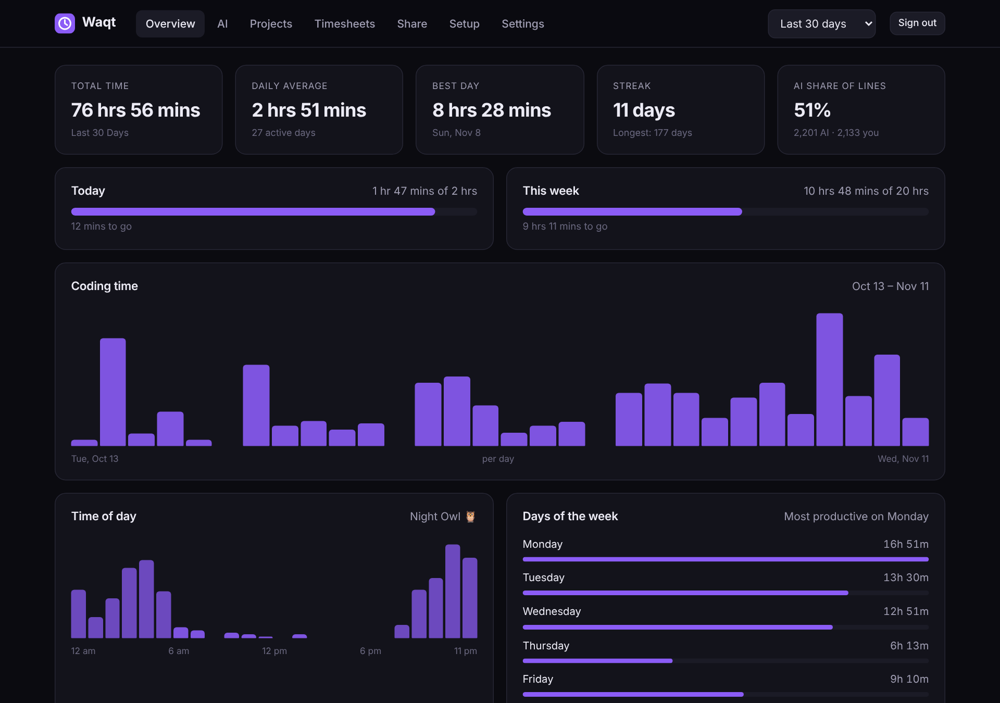
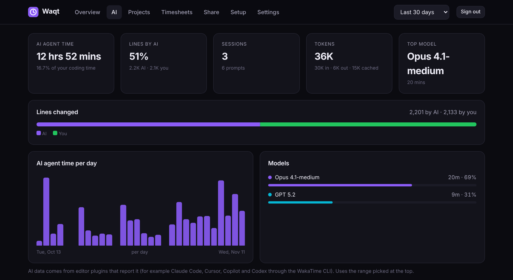

<div align="center">


# Waqt

**A free, self-hosted coding time tracker.**
Works with every WakaTime editor plugin. Runs on Cloudflare's free plan.
Keeps your whole history. Costs nothing.

[](https://deploy.workers.cloudflare.com/?url=https://github.com/mohdrafey1/waqt)

</div>



*Waqt* (وقت / वक़्त) means "time" in Urdu and Hindi.

## Why

WakaTime's free plan only keeps 1 week of history. Waqt is a small server you run on your own Cloudflare account. It speaks the same API, so the official WakaTime plugins for 70+ editors send your activity to **your** server instead. You get:

- **Your full history, forever.** Daily totals are never deleted, and you can **import your old WakaTime history** in one click.
- **A private dashboard** with projects, languages, editors, activity type, OS, machines, time of day, days of the week and a year heatmap.
- **AI insights.** Time spent with AI agents, the share of lines written by AI vs. you, sessions, prompts, tokens and time per model (Claude Code, Cursor, Copilot, Codex…).
- **Tidy projects.** Rename or merge projects and label them, for example by client. Open any project to see its **files and branches**.
- **Goals, nudges and a weekly report** to Discord or Telegram: a message when you hit a goal or your streak is about to end, and goal progress right in your editor's status bar.
- **AI cost estimate.** What your token use would cost at API list prices, from a price table you can edit.
- **Timesheets** with hourly rates per client, CSV export and printable invoices.
- **README cards, badges and a stats block** for your GitHub profile, plus **a public profile page** you can share or embed on your portfolio.
- **Waqt Wrapped.** Your year in code as shareable slides and an image.
- **A friends leaderboard** with anyone who has a public Waqt or WakaTime profile.
- **Keep WakaTime too, if you want.** Waqt can pass every heartbeat on to WakaTime (with retries), so your WakaTime account and anything built on it keep working.
- **Privacy by default.** Project names, labels, machine names and file paths are never public unless you say so.
- **Safe keys.** Each editor gets its own revocable key that can only send activity; the dashboard has its own password and secure sign-in.
- **Backups** you can download, restore, or have saved weekly to your private GitHub repository.
- **Updates arrive by themselves** through a weekly GitHub Action in your copy, and the dashboard tells you what's new.
- **Stays inside the free plan,** with a usage meter that warns you long before any limit.
- **₹0 / $0.** No credit card, no subscription. Cloudflare's free plan is plenty for one person.



## Deploy in about two minutes

1. **Make a key.** It must be a lowercase UUID v4, because the WakaTime plugins reject anything else. Open your browser console and run:
   ```js
   crypto.randomUUID()
   ```
   or use [uuidgenerator.net/version4](https://www.uuidgenerator.net/version4). Keep it somewhere safe.
2. **Click [Deploy to Cloudflare](https://deploy.workers.cloudflare.com/?url=https://github.com/mohdrafey1/waqt).** Sign in (or sign up free) and fill in the setup screen like this:

   | On Cloudflare's screen | Choose |
   | --- | --- |
   | Git account | your GitHub account |
   | Repository name | anything, e.g. `waqt` |
   | Create private Git repository | **on** (backups are only safe in a private repository) |
   | D1 database | **Create new** |
   | Enable read replication | off (not needed for one person) |
   | `API_KEY` | the key from step 1 |
   | Enable Preview builds | **off** (previews would share your real database) |
   | Protect with Cloudflare Access | **off** (editors can't get through Access; Waqt has its own sign-in) |
   | Advanced settings | leave as they are |

   Click **Deploy**. Cloudflare copies this repo to your GitHub, creates the database and deploys it.
3. **Open your Worker URL** (something like `https://waqt.<you>.workers.dev`) and sign in with your key.

Every push to your copy of the repo redeploys automatically.

### After deploying: a 5-minute checklist

1. **Settings → Sign-in and device keys:** set a dashboard password, so you never paste the key into a browser again.
2. **Setup:** click **Create a key for this device**, copy the snippet into `~/.wakatime.cfg` and restart your editor (details below). Repeat on each computer.
3. *Optional,* **your own domain:** Cloudflare → your Worker → Settings → Domains & Routes → Add → Custom domain (e.g. `waqt.example.com`).
4. *Optional,* **keep WakaTime and import your history:** add two **Secrets** to the Worker (see below): `WAKATIME_API_KEY` from [wakatime.com/api-key](https://wakatime.com/api-key) to keep sending activity to WakaTime, and `WAKATIME_OAUTH_TOKEN` from [wakatime.com/oauth](https://wakatime.com/oauth) to import. Then Setup → **Test the WakaTime key** and **Import from WakaTime**.
5. *Optional,* **GitHub side of your copy** (Settings → Secrets and variables → Actions on GitHub, *not* in Cloudflare):
   - weekly backups: secret `WAQT_API_KEY` (your main key) and variable `WAQT_URL` (your Waqt address);
   - updates: allow Actions to open pull requests (Settings → Actions → General → "Allow GitHub Actions to create and approve pull requests"), or set the variable `WAQT_UPDATE_MODE` to `direct`.

> **Common mix-ups:** Cloudflare variables are for the Worker (`API_KEY`, `WAKATIME_API_KEY`, `WAKATIME_OAUTH_TOKEN`); GitHub variables are for the workflows (`WAQT_URL`, `WAQT_UPDATE_MODE`, backups). Add keys in Cloudflare as **Secret**, not Text. WakaTime has two different credentials: the **API key** ([wakatime.com/api-key](https://wakatime.com/api-key)) only works for sending activity, the way plugins do, and the **personal OAuth token** ([wakatime.com/oauth](https://wakatime.com/oauth)) is needed to read your history.

## Connect your editors

1. Install the WakaTime plugin for your editor from [wakatime.com/plugins](https://wakatime.com/plugins). You don't need a WakaTime account.
2. Edit `~/.wakatime.cfg` (Windows: `%USERPROFILE%\.wakatime.cfg`):
   ```ini
   [settings]
   api_url = https://waqt.<you>.workers.dev/api/v1
   api_key = <a device key>
   ```
3. Restart your editor. After a couple of minutes your status bar shows today's time and the dashboard fills in.

The dashboard's **Setup** tab shows this snippet with your real URL filled in. Click **Create a key for this device** to get a key just for this editor or computer (your main `API_KEY` works too).

### Keys and signing in

- **Device keys** can send heartbeats and read your stats, which is all an editor needs. They can't open the dashboard or change settings, backups or other keys. Create one per computer in **Setup**; revoke it any time in **Settings → Sign-in and device keys**. Waqt stores only a SHA-256 fingerprint, so a copy of the database doesn't reveal them.
- **The dashboard** signs in with your password (or the main key) and keeps you signed in for 30 days with an HttpOnly, Secure, SameSite=Strict cookie. Password guesses are rate limited, and Settings lists signed-in browsers with a button to sign out the others.
- **The main key** (`API_KEY` secret) always works for everything. Keep it for emergencies and automation such as backups.

### Keep sending to WakaTime too (optional)

Your editor can only send to one server, so Waqt can forward every heartbeat to WakaTime for you. In Cloudflare open your Worker → **Settings → Variables and Secrets → Add**, choose **Secret**, name it `WAKATIME_API_KEY` and paste your **Secret API Key** from [wakatime.com/api-key](https://wakatime.com/api-key) (it starts with `waka_`).

Waqt sends the heartbeats exactly as your editor sent them (AI fields, dependencies, user agent, machine name and time zone included), in the background, so your editor never waits on WakaTime. If WakaTime is down, batches are queued and retried for up to two weeks. The dashboard's **Setup** tab shows whether forwarding is working and lets you switch it off. To forward to another WakaTime-compatible server (Wakapi, Hackatime…) instead, also add a `WAKATIME_API_URL` variable such as `https://wakapi.dev/api`.

### Import your WakaTime history

WakaTime only lets API keys *send* activity (what plugins do); reading your history needs your **personal OAuth token**. Copy it from [wakatime.com/oauth](https://wakatime.com/oauth) and add it to the Worker as a second **Secret** named `WAKATIME_OAUTH_TOKEN`. Then open **Setup → Test the WakaTime key** (both lines should show ✓) and **Import from WakaTime**. Waqt asks WakaTime for an export of all your heartbeats, your browser counts the time (with the same code the server uses) and Waqt stores compact daily totals, including time of day, AI usage, files and branches. Only days before Waqt's first heartbeat are imported, so nothing is counted twice. WakaTime keeps an export for a while and won't make a new one until it expires, so if the export is a few days old, Waqt fetches the missing days one at a time. If the import says WakaTime refused the credential, **Test the WakaTime key** shows WakaTime's own reason. Importing again replaces the previous import, and **Remove imported data** undoes it. You can also upload an export file you downloaded from WakaTime yourself.

## Add stats to your GitHub README

Turn on **Public profile** in Settings (it's on by default), then use the **Share** tab to build a card, or write the URL yourself:

| Card | Example |
| --- | --- |
| Top languages |  |
| Coding stats |  |
| Time of day |  |
| AI coding |  |
| Badge |  |


```md


```

**Cards:** `languages`, `editors`, `os`, `categories`, `projects` (only if project names are public), `stats`, `heatmap`, `hours`, `ai`, `wrapped` (see below).

| Option | Values | Default |
| --- | --- | --- |
| `range` | `today`, `yesterday`, `last_7_days`, `last_30_days`, `last_6_months`, `last_year`, `all_time` | `last_7_days` |
| `theme` | `auto` (follows the viewer's light/dark mode), `light`, `dark`, `transparent` | `auto` |
| `layout` | `list`, `compact` | `list` |
| `count` | 1–12 items | `6` |
| `hide` | comma-separated names, e.g. `json,markdown` | |
| `accent` | hex color without `#`, e.g. `22c55e` | `8b5cf6` |
| `title` | custom title | |
| `width` | 300–600 | per card |
| `hide_border` | `true` | |
| `cache_seconds` | 300–86400 | `1800` |

**Badges:** `/badge/<range>.svg` with optional `label`, `color` (hex) and `style=flat-square`. A [Shields.io endpoint](https://shields.io/badges/endpoint-badge) is at `/badge/<range>.json`.

### Waqt Wrapped

`/wrapped/` walks through your year in code: total time, active days and longest streak, languages, when you code, your tools, AI use and (if public) projects. It ends with a card you can download as an image, post to X or LinkedIn, or embed:


```md
[](https://waqt.<you>.workers.dev/wrapped/?year=2026)
```

Wrapped uses your public stats, so it shows exactly what anyone else would see. Add `?year=2025` for earlier years.

### A stats block in your profile README

Like the WakaTime README bots, but from Waqt: languages, editors, projects, OS, time of day (Night Owl or Early Bird), most productive weekday, AI use and your streak, as a text block.

1. Add these two lines to your profile README where the block should go:
   ```md
   <!--START_SECTION:waqt-->
   <!--END_SECTION:waqt-->
   ```
2. Optional: add your Waqt key as a repository secret named `WAQT_API_KEY` to include private data such as project names.
3. Save this as `.github/workflows/waqt.yml` in that repository:
   ```yaml
   name: Waqt stats
   on:
     schedule:
       - cron: '17 */6 * * *'
     workflow_dispatch:
   permissions:
     contents: write
   jobs:
     update:
       runs-on: ubuntu-latest
       steps:
         - uses: actions/checkout@v4
         - uses: mohdrafey1/waqt/readme-action@main
           with:
             url: https://waqt.<you>.workers.dev
             api_key: ${{ secrets.WAQT_API_KEY }}
             range: last_7_days
   ```

Options: `range`, `sections` (`summary,languages,editors,projects,os,categories,hours,weekdays,ai,streak`), `readme`, `section_name`, `commit_message`. It only commits when your stats changed. The raw markdown is at `/api/v1/users/<user>/readme.md`.

## Embed on your website

The public profile lives at `https://waqt.<you>.workers.dev/profile/`. To embed it:

```html
<iframe
  src="https://waqt.<you>.workers.dev/profile/?embed=1&range=last_30_days&sections=stats,heatmap,languages"
  width="100%" height="560" style="border:0" loading="lazy" title="My coding activity"></iframe>
```

Options: `range` (`last_7_days`, `last_30_days`, `last_year`, `all_time`), `theme` (`auto`, `dark`, `light`), `sections` (`stats`, `heatmap`, `daily`, `hours`, `ai`, `languages`, `editors`, `categories`, `os`, `projects`). The SVG cards above also work as plain `` tags on any site, and every public JSON endpoint sends CORS headers so you can build your own widget.

## Goals, reports, friends and timesheets

- **Goals:** set a daily and/or weekly goal in **Settings**. Progress bars show on the Overview, and **Show daily goal progress in my editor** makes the status bar read e.g. `1 hr 20 mins · 67% of 2 hrs`.
- **Nudges:** with a Discord or Telegram channel set up, Waqt can message you when you reach a goal, and remind you at an hour you pick (21:00 by default) when a streak of two days or more would end at midnight. Each goes out once.
- **Weekly report:** add a Discord webhook (Server settings → Integrations → Webhooks) and/or a Telegram bot (create one with @BotFather, get your chat ID from @userinfobot). Every Monday from 9:00 your time you get last week's total vs. the week before, goal hits, best day, top languages, projects and labels, AI use and your streak. **Send a test report** tries it right away.
- **Projects tab:** rename projects, merge several into one by giving them the same name, label them (e.g. by client) and hide them from public views. Click a project for its daily time, branches, languages, editors and busiest files (paths relative to the project folder; private).
- **AI tab:** besides agent time, lines, sessions and models, a **cost estimate** turns your token counts into what they'd cost at API list prices (USD per million input, output and cached tokens). Edit the price table to match your models; the longest matching name wins. It's private unless you choose to show it on your profile, cards and README.
- **Friends tab:** a private leaderboard for the last 7 or 30 days with up to 25 friends who have a public Waqt (`https://their-waqt.example.com`) or WakaTime profile (`https://wakatime.com/@name`).
- **Timesheets tab:** pick a period, group by label or project, round each day up to 6/15/30/60 minutes, set an hourly rate per label and a currency, then **Export CSV** or **Print invoice** (Save as PDF works too).

## Backups

A backup holds every daily total (everything the dashboard, cards and API show) and your settings, as a small `.json.gz` file. Secrets such as webhooks and your password are left out, and so are raw heartbeats.

- **By hand:** Setup → Backups → **Download a backup** or **Restore a backup**. Restoring replaces the same days and keeps the rest, so you can also use it to move to a new Cloudflare account.
- **Every week, automatically:** in your **private** GitHub copy, add the secret `WAQT_API_KEY` (your main key) and the variable `WAQT_URL` (your Waqt address) under Settings → Secrets and variables → Actions. The *Back up Waqt* workflow then saves a backup as a release every Sunday and keeps the last 12 (`WAQT_BACKUP_KEEP` changes that). It refuses to run in a public repository unless you set `WAQT_BACKUP_PUBLIC` to `true`.
- **From a terminal:** `WAQT_URL=… WAQT_API_KEY=… node scripts/backup.mjs backup` (or `restore waqt-backup-2026-11-15.json.gz`).

## Staying up to date

The Deploy button makes a copy of Waqt in your GitHub account (not a fork), so updates can't arrive by themselves. Your copy includes `.github/workflows/waqt-update.yml`, which once a week pulls the latest Waqt, keeps your own Worker name, database, routes and variables, and opens an **Update Waqt** pull request. Merge it and Cloudflare redeploys; database changes are applied during the deploy.

- To apply updates automatically instead, add the repository variable `WAQT_UPDATE_MODE` = `direct` (Settings → Secrets and variables → Actions → Variables).
- If GitHub doesn't allow the workflow to open pull requests, the run summary links to the ready-made branch, or allow it in Settings → Actions → General → "Allow GitHub Actions to create and approve pull requests".
- You can run it any time from the **Actions** tab.
- GitHub doesn't let a workflow change files in `.github/workflows` with its own token. When those change, the run lists them for you to copy by hand. To include them automatically, add a secret `WAQT_UPDATE_TOKEN`: a [fine-grained token](https://github.com/settings/personal-access-tokens/new) for your copy with **Contents**, **Pull requests** and **Workflows** set to read and write.
- The dashboard shows your version (Setup → Status) and tells you when a new one is out. See the [changelog](CHANGELOG.md) for what changed.

## Works with WakaTime tools

Waqt implements the parts of the WakaTime API that editors and popular tools use:

| Endpoint | Used by |
| --- | --- |
| `POST /api/v1/users/current/heartbeats.bulk` | every editor plugin (via wakatime-cli) |
| `GET /api/v1/users/current/statusbar/today` | the "today" time in your status bar |
| `GET /api/v1/users/:user/stats/:range` | [github-readme-stats](https://github.com/anuraghazra/github-readme-stats), dashboards |
| `GET /api/v1/users/current/summaries` | scripts and integrations |
| `GET /api/v1/users/:user/all_time_since_today` | profile widgets |
| `GET /api/v1/users/:user/readme.md` | the README stats block |

Use `current` with your key for private data. Any other username returns the public view. Examples:

```md

```

```yaml
# athul/waka-readme GitHub Action
- uses: athul/waka-readme@master
  with:
    WAKATIME_API_KEY: ${{ secrets.WAQT_API_KEY }}
    API_BASE_URL: https://waqt.<you>.workers.dev/api
```

## Will it stay free?

Yes, for one person. Rough numbers for a heavy coder:

| Cloudflare free plan | Allowance | Waqt's typical use |
| --- | --- | --- |
| Worker requests | 100,000 / day | ~1,000–3,000 |
| D1 rows written | 100,000 / day | ~3,000 (a one-time import of a few years: ~50,000) |
| D1 rows read | 5,000,000 / day | well under 10% |
| D1 storage | 5 GB (500 MB per database) | ~150 MB per year of raw data |

**Setup → Cloudflare free plan usage** shows today's requests, database reads and writes and the database size against these limits, and the Overview warns you at 70%.

To stay under the 500 MB limit, raw heartbeats older than **365 days** are deleted by a daily job (change it in Settings, `0` = keep forever). Daily totals per project, language, editor, OS, machine and activity are **kept forever**, so your all-time stats and heatmap never lose history. Public stats are cached for 10 minutes so a busy README doesn't use up your reads.

## How it works

```
editor plugin → wakatime-cli → POST heartbeats → Cloudflare Worker → D1 (SQLite)
                                                        │
                       cron every 15 min: heartbeats → daily summaries
                                                        │
             dashboard · README cards · badges · profile page · WakaTime-style API
```

Time is counted the way WakaTime counts it: each heartbeat gets credit for the gap until the next one, as long as that gap is under the idle timeout (15 minutes by default).

| Path | What's there |
| --- | --- |
| `src/routes/api.ts` | WakaTime-compatible API, settings, timesheet and reports |
| `src/routes/importer.ts` | WakaTime history import |
| `src/routes/cards.ts` | SVG cards and badges |
| `src/ingest.ts` | validates and stores heartbeats |
| `public/lib/core.js` | how time is counted (shared by the Worker and the browser) |
| `src/summaries.ts` | turns heartbeats into daily totals, pruning |
| `src/stats.ts` | stats queries and the public cache |
| `src/forward.ts` | optional forwarding to WakaTime, with a retry queue |
| `src/report.ts`, `src/nudges.ts` | weekly report, goal and streak messages to Discord / Telegram |
| `src/auth.ts`, `src/routes/auth.ts` | device keys, dashboard password and sessions |
| `src/routes/backup.ts`, `public/lib/backup.js`, `scripts/backup.mjs` | backups and restore |
| `src/friends.ts`, `src/pricing.ts`, `src/usage.ts`, `src/version.ts` | friends leaderboard, AI cost estimate, free-plan meter, update check |
| `src/readme.ts`, `readme-action/` | the profile README stats block and its GitHub Action |
| `public/` | dashboard, profile page and Wrapped (plain HTML/JS, no build step) |
| `migrations/` | D1 schema |
| `test/` | tests that run inside the Workers runtime |

## Run it locally

```bash
git clone https://github.com/<you>/waqt && cd waqt
npm install
cp .dev.vars.example .dev.vars   # then put a UUID v4 in it
npm run dev                      # http://localhost:8787
```

Point a local `~/.wakatime.cfg` at `http://localhost:8787/api/v1` to test with a real editor.

```bash
npm test          # 76 tests in the Workers runtime (Vitest + @cloudflare/vitest-plugin)
npm run typecheck
```

## Deploy with the CLI instead

```bash
npm install
npx wrangler d1 create waqt          # copy the database_id into wrangler.json
npx wrangler secret put API_KEY      # paste your UUID v4
npm run deploy                       # applies migrations, then deploys
```

## FAQ

**Does any data go to WakaTime?** Only if you turn on forwarding with the `WAKATIME_API_KEY` secret. Otherwise the plugins only talk to the `api_url` you set.

**Can I import my old WakaTime history?** Yes: Setup → Import from WakaTime (needs the `WAKATIME_OAUTH_TOKEN` secret, your personal token from wakatime.com/oauth), or upload an export file.

**Is it multi-user?** No. One instance per person keeps it simple and inside the free plan. Anyone can deploy their own with the button above.

**I lost my key.** Device keys: revoke the old one in Settings and create a new one in Setup. The main key: set a new `API_KEY` in the Cloudflare dashboard → Workers → waqt → Settings → Variables and Secrets (and update anything that used it).

**I forgot my dashboard password.** Sign in with the main key instead, then set a new password in Settings.

## License

[MIT](LICENSE). Not affiliated with WakaTime. "WakaTime" is a trademark of its owner. Waqt only uses its open-source, BSD-licensed editor plugins as clients.
